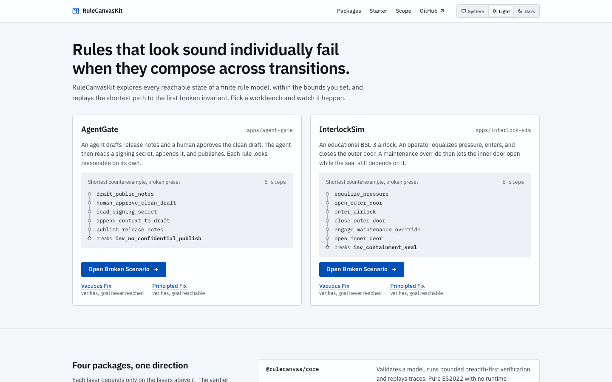
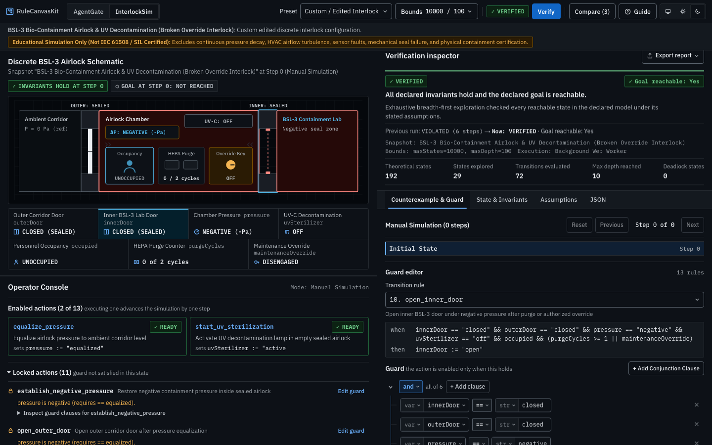

# RuleCanvasKit

Verify your rules before deployment.

## Project Overview

RuleCanvasKit is a TypeScript finite-state verification toolkit for Guarded Transition Systems (GTS). You declare a bounded state schema, guarded transition rules, invariants, an optional goal predicate, and explicit modeling assumptions (`ModelAssumption[]`). The core verifier explores reachable states in deterministic breadth-first order, returns the shortest counterexample it finds, verifies invariants after complete exploration, or reports an inconclusive verdict when a state or depth bound stops exploration.

The monorepo pairs four acyclic library packages (`@rulecanvas/core`, `@rulecanvas/ui`, `@rulecanvas/workbench`, and `@rulecanvas/workbench-react`) with two browser reference applications (`AgentGate` and `InterlockSim`), a static landing hub (`site/`), a standalone starter template (`templates/workbench-starter/`), and a deterministic CLI model checker (`pnpm check:model`).

## Live Demo

RuleCanvasKit is the reusable verification toolkit; **AgentGate** and **InterlockSim** are its two reference applications, with AgentGate serving as the primary practical use case for verifying AI agent permission and approval policies before rollout.

- **RuleCanvasKit:** https://rulecanvaskit.pages.dev/
- **AgentGate:** https://rulecanvaskit.pages.dev/agent-gate/
- **InterlockSim:** https://rulecanvaskit.pages.dev/interlock-sim/

## Real-World Problems Solved

Access policies, approval workflows, and discrete interlock logic often appear sound when each rule is reviewed in isolation, yet break when permitted transitions compose across multiple steps:

- **Multi-step approval bypasses**: An AI agent workflow may obtain human approval on a clean draft, read sensitive data into context, append that data to the draft, and publish externally while reusing a stale approval flag.
- **Incomplete or vacuous fixes**: Ad-hoc rule patches often block one known attack path while leaving an alternate multi-step path open, or disable a transition so aggressively that legitimate workflows can never reach their intended goal.
- **Interlock override hazards**: Discrete safety controllers can allow maintenance overrides, bypass flags, and state transitions to combine into a hazardous state that violates mutual-exclusion invariants.

RuleCanvasKit surfaces shortest-path multi-step counterexamples before deployment, replays traces deterministically step by step, and checks both invariant preservation and goal reachability for candidate fixes.

## Key Features

- **Zero-dependency pure ES2022 verification core (`@rulecanvas/core`)**: Strict TypeScript (`"lib": ["ES2022"]`, `"types": []`) with zero runtime dependencies, exact `bigint` arithmetic, atomic pre-state updates, `-0` normalization, and `OUT_OF_DOMAIN_TRANSITION` diagnostics instead of silent clamping.
- **Total untrusted-input validation**: `validateModel`, `validateOptions`, `verifyModel`, and all replay APIs accept `unknown` inputs, enforce structural and AST complexity bounds, reject own accessors and reserved prototype keys without invoking user getters or coercion methods, and catch exotic `Proxy` trap errors into structured `ValidationError` diagnostics.
- **Four explicit verification verdicts**:
  - `VERIFIED`: Every reachable state satisfies all declared invariants (and reports `goalReachable` when a goal is defined).
  - `VIOLATED`: Returns the shortest counterexample trace (`s0 -> ... -> v`), terminal state, and violated invariant IDs in declaration order.
  - `INCONCLUSIVE`: Returned when `maxStates` or `maxDepth` stops exploration, with `completedDepth` and `frontierRemaining` counts.
  - `INVALID`: Returned with structured `ValidationError` diagnostics for malformed inputs, invalid options, or reachable out-of-domain transitions.
- **Deterministic replay & audit reporting (`@rulecanvas/ui`)**: Trace and manual step replay backed by `@rulecanvas/core`, XSS-safe HTML renderers, provenance-tagged JSON/Markdown reports (`'validated-snapshot'` vs. `'recomputed-core'`), and same-model verdict delta analysis (`computeVerdictDelta`).
- **Worker transport & strict portable JSON codec (`@rulecanvas/workbench`)**: Framework-independent Web Worker / main-thread verification client with detached capture, allowlisted result reconstruction (`sanitizeAndFreezeVerifyResult`), and a portable JSON codec enforcing pre-parse `duplicateKeys: 'reject'` and RFC 8259 integer checking.
- **React 19 workbench adapters (`@rulecanvas/workbench-react`)**: Snapshot-bound verification hooks (`useVerificationSnapshot`), accessible verdict/delta/assumption views, `ExportReportMenu`, same-origin navigation (`WorkbenchNavigation`, `WorkbenchBrandLink`), and race-safe `?preset=...` URL routing.

## Applications

Both reference applications are React 19 + Vite workbenches built on the four shared packages and styled with [DESIGN.md](./DESIGN.md) tokens and self-hosted IBM Plex fonts (zero external CDN requests). Each runs verification in a Background Web Worker, synchronizes `?preset=...` URLs with discard protection, rejects duplicate JSON keys under `DEFAULT_MODEL_JSON_LIMITS`, exports deterministic reports (`ExportReportMenu`), and displays before/after verdict deltas (`VerdictDeltaRow`).

### AgentGate (`apps/agent-gate`) — Primary Reference Application

AgentGate models AI agent permission and approval-laundering policies before rollout. Its three-pane desktop workspace pairs a persistent rule navigator, a structured rule and guard AST editor, and a tabbed verification inspector (`Trace`, `State & Diff`, `Invariants & Goal`, `Assumptions`). Trace steps jump directly to their rules, candidate guard repairs can be staged and verified against goal reachability, and `Compare (5)` evaluates all five built-in presets side by side.

### InterlockSim (`apps/interlock-sim`)

InterlockSim is an educational discrete-state BSL-3 airlock interlock workbench (`broken`, `fixed`, and `vacuous` presets). It pairs a live containment schematic and operator console with an inspector for counterexample replay (`Reset`, `Previous`, `Next`, `Restore Counterexample`), guard editing, assumptions, JSON import/export, guided repair staging, and three-preset comparison (`Compare (3)`).

## Screenshots

Three desktop (`1440×900`) views from the `v0.8.0` static hub and reference workbenches:



*RuleCanvasKit homepage (Light mode): states the multi-step composition problem and links directly to broken, vacuous, and principled-fix presets for both applications.*


*AgentGate (Light mode): replays the 5-step approval-laundering counterexample (`VIOLATED`, `inv_no_confidential_publish`) alongside the candidate `!modifiedSinceApproval` guard repair and Verification Inspector.*



*InterlockSim (Dark mode): shows the repaired airlock configuration (`VERIFIED`, `Goal reachable: Yes`, `VerdictDeltaRow`, and `Background Web Worker` execution) alongside the discrete schematic and operator console.*

## Architecture

RuleCanvasKit enforces an acyclic four-library package graph (`@rulecanvas/core` -> `@rulecanvas/ui` & `@rulecanvas/workbench` -> `@rulecanvas/workbench-react` -> `apps/*`). `core`, `ui`, and `workbench` compile under strict pure ES2022 with zero `node:*`, third-party npm, or non-deterministic host-global imports. AST boundary tests enforce these rules automatically. See [docs/ARCHITECTURE.md](./docs/ARCHITECTURE.md) for engine semantics, validation bounds, and layering details.

```text
.github/                 # CI workflow, issue templates, and pull request template
.kiro/                   # Versioned steering rules, boundary-auditor agent, hooks, and specs
packages/
  rulecanvas-core/       # @rulecanvas/core: pure ES2022 validator, compiler, BFS verifier, replay APIs
  rulecanvas-ui/         # @rulecanvas/ui: formatters, replay controller, HTML renderers, reports, delta
  rulecanvas-workbench/  # @rulecanvas/workbench (private): worker transport, capture/freeze, JSON codec
  rulecanvas-workbench-react/ # @rulecanvas/workbench-react (private): React 19 UI adapters & routing
apps/
  agent-gate/            # @rulecanvas/agent-gate: AI agent permission and approval policy workbench
  interlock-sim/         # @rulecanvas/interlock-sim: educational BSL-3 airlock interlock workbench
site/                    # Static landing hub with relative preset links and theme synchronization
templates/
  workbench-starter/     # Standalone CI/CD release-gate React workbench installed from local tarballs
scripts/                 # Verification, packaging, CLI checker, hygiene, and release preflight tools
tests/                   # Browser E2E, hub claim, parity, CLI, and release preflight suites
docs/                    # Architecture, release notes, tooling attribution, and submission docs
```

| Package | Version | Visibility | Export Subpaths | Primary Role | Documentation |
| --- | --- | --- | --- | --- | --- |
| `@rulecanvas/core` | `0.1.0` | Packable | `.` | Pure ES2022 GTS validator, BFS verifier, and replay APIs | [README](./packages/rulecanvas-core/README.md) |
| `@rulecanvas/ui` | `0.8.0` | Packable | `.` | Formatters, replay controller, HTML renderers, reports, delta, diagnostics | [README](./packages/rulecanvas-ui/README.md) |
| `@rulecanvas/workbench` | `0.8.0` | Private | `./verify`, `./verify-worker`, `./model-json` | Worker/main-thread transport, detached capture, portable JSON codec | [README](./packages/rulecanvas-workbench/README.md) |
| `@rulecanvas/workbench-react` | `0.8.0` | Private | `.` | React 19 workbench controls, snapshot hook, reports, delta, nav, routing | [README](./packages/rulecanvas-workbench-react/README.md) |

## Installation and Quick Start

Prerequisites: Node.js `^22.12.0 || ^24.0.0 || >=26.0.0` (Node 24 LTS recommended; CI runs Node 24) and `pnpm` (`12.21.0`). Python 3 (`python3`, standard library only) is additionally required when packing release archives from source (`pnpm run pack:local`, `pnpm verify:pack`) or running release preflight (`pnpm verify:release:preflight`, `pnpm test:release:preflight`).

```bash
git clone https://github.com/iamramchandrakarki/rulecanvas-kit.git
cd rulecanvas-kit
pnpm install --frozen-lockfile
pnpm build
pnpm test
```

Run either interactive browser workbench locally:

```bash
# AgentGate workbench (AI agent approval policy verification)
pnpm --filter @rulecanvas/agent-gate dev

# InterlockSim workbench (educational BSL-3 airlock interlock simulator)
pnpm --filter @rulecanvas/interlock-sim dev
```

For same-origin sibling static hosting (`site/` at root with `agent-gate/` and `interlock-sim/` subdirectories), see [docs/releases/workbench-integration.md](./docs/releases/workbench-integration.md).

## Usage Examples

Declare a bounded model with a schema, transition rules, invariants, an optional goal, and explicit assumptions, then run `verifyModel` and replay any counterexample with `replayTrace`:

```ts
import {
  replayTrace,
  verifyModel,
  type TransitionSystemModel,
} from '@rulecanvas/core';

const model: TransitionSystemModel = {
  id: 'release-gate',
  name: 'Two-Step Release Gate',
  schema: {
    reviewed: { kind: 'boolean' },
    stage: { kind: 'enum', values: ['draft', 'staging', 'prod'] },
  },
  initialState: {
    reviewed: false,
    stage: 'draft',
  },
  rules: [
    {
      id: 'promote-staging',
      label: 'Promote draft to staging',
      guard: { op: 'eq', left: { op: 'var', name: 'stage' }, right: { op: 'lit', value: 'draft' } },
      updates: [{ var: 'stage', value: { op: 'lit', value: 'staging' } }],
    },
    {
      id: 'promote-prod',
      label: 'Promote staging to prod',
      guard: { op: 'eq', left: { op: 'var', name: 'stage' }, right: { op: 'lit', value: 'staging' } },
      updates: [{ var: 'stage', value: { op: 'lit', value: 'prod' } }],
    },
    {
      id: 'complete-review',
      label: 'Mark change reviewed',
      guard: { op: 'not', arg: { op: 'var', name: 'reviewed' } },
      updates: [{ var: 'reviewed', value: { op: 'lit', value: true } }],
    },
  ],
  invariants: [
    {
      id: 'prod-requires-review',
      label: 'Production deployments must be reviewed',
      holds: {
        op: 'or',
        args: [
          { op: 'neq', left: { op: 'var', name: 'stage' }, right: { op: 'lit', value: 'prod' } },
          { op: 'var', name: 'reviewed' },
        ],
      },
    },
  ],
  goal: {
    id: 'reach-prod',
    label: 'Reach production safely',
    reached: { op: 'eq', left: { op: 'var', name: 'stage' }, right: { op: 'lit', value: 'prod' } },
  },
  assumptions: [
    {
      id: 'atomic-transitions',
      category: 'execution',
      statement: 'Each rule executes atomically against the current discrete state.',
      notModeled: 'Out-of-band manual changes or concurrent pipeline races.',
    },
  ],
};

const result = verifyModel(model, { maxStates: 1_000, maxDepth: 20 });

if (result.status === 'VIOLATED') {
  const ruleIds = result.trace.map((step) => step.ruleId);
  const replayed = replayTrace(model, ruleIds);
  console.log('Shortest counterexample:', ruleIds, replayed);
}
```

## Starter Template and CLI Integration

- **Standalone starter template (`templates/workbench-starter/`)**: A runnable CI/CD production release-gate React workbench consumed outside the monorepo from local tarballs (`pnpm run pack:local`). See [templates/workbench-starter/README.md](./templates/workbench-starter/README.md) for copy, offline install, test, typecheck, and Vite build instructions.
- **CLI model checker (`pnpm check:model`)**: Verifies saved model JSON files using `recomputed-core` provenance with strict duplicate-key rejection:

```bash
pnpm check:model model.json
pnpm check:model model.json --markdown --max-states 10000 --max-depth 100
pnpm check:model model.json --allow-vacuous
```

`pnpm check:model` exits `0` only on non-vacuous `VERIFIED` (or vacuous `VERIFIED` with `--allow-vacuous`), `1` on `VIOLATED`, `INCONCLUSIVE`, runtime `INVALID`, or unallowed vacuous `VERIFIED`, and `2` on CLI usage or JSON decode errors.

## Testing and Verification

```bash
pnpm build
pnpm typecheck
pnpm --filter @rulecanvas/core exec tsc --noEmit -p tsconfig.json
pnpm --filter @rulecanvas/ui exec tsc --noEmit -p tsconfig.json
pnpm --filter @rulecanvas/workbench exec tsc --noEmit -p tsconfig.json
pnpm --filter @rulecanvas/workbench-react exec tsc --noEmit -p tsconfig.json
pnpm verify:exports
pnpm verify:pack
pnpm test
FC_SEED=918273645 pnpm --filter @rulecanvas/core exec vitest run tests/properties.test.ts
FC_SEED=918273645 pnpm --filter @rulecanvas/ui exec vitest run tests/report.properties.test.ts tests/delta.test.ts
pnpm test:cli
pnpm verify:boundaries
pnpm verify:hygiene
pnpm test:release:preflight
pnpm bench
```

To run the headless Chromium browser E2E and WCAG A/AA accessibility suite (`pnpm test:browser`):

```bash
qa_dir=$(mktemp -d)
npm install --no-save --prefix "$qa_dir" playwright@1.65.1 @axe-core/playwright@4.14.1
"$qa_dir/node_modules/.bin/playwright" install chromium
STARTER_FIXTURE_DIST="$qa_dir/starter" pnpm verify:pack
PLAYWRIGHT_MODULE="$qa_dir/node_modules/playwright/index.mjs" \
  AXE_PLAYWRIGHT_MODULE="$qa_dir/node_modules/@axe-core/playwright/dist/index.mjs" \
  STARTER_FIXTURE_DIST="$qa_dir/starter" \
  SCREENSHOT_DIR="$qa_dir/screenshots" pnpm test:browser
```

## Known Limitations

- **Model-scoped verification only**: Verdicts apply strictly to declared finite-state models under their exploration bounds and explicit `ModelAssumption[]` assumptions.
- **Design-time policy modeling (`AgentGate`)**: Evaluates discrete permission and approval state machines at design time; it is not a live runtime firewall, prompt-injection classifier, or production scanner.
- **Educational interlock modeling (`InterlockSim`)**: Models discrete interlock logic for educational exploration only; it does not model continuous physics, sensor failures, or hardware timing and is not certified for IEC 61508 / SIL engineering.
- **Bounded exploration and JSON limits**: Core exploration caps `maxStates <= 100,000`, `maxDepth <= 10,000`, and AST `depth <= 32` / `visits <= 256`; portable JSON defaults to `512,000` characters and `10,000` nodes (`2,000,000` / `50,000` hard ceiling).
- **Private workbench packages**: `@rulecanvas/workbench` and `@rulecanvas/workbench-react` remain `"private": true` workspace packages verified via local tarballs (`pnpm verify:pack`, `pnpm run pack:local`).

## Contribution

See [CONTRIBUTING.md](./CONTRIBUTING.md) for prerequisites, commit conventions, packaging/layering invariants, and local verification steps. See [SECURITY.md](./SECURITY.md) for threat-boundary details and vulnerability reporting, and [docs/TOOL_ATTRIBUTION.md](./docs/TOOL_ATTRIBUTION.md) for development tooling disclosure.

## License

MIT. See [LICENSE](./LICENSE).
