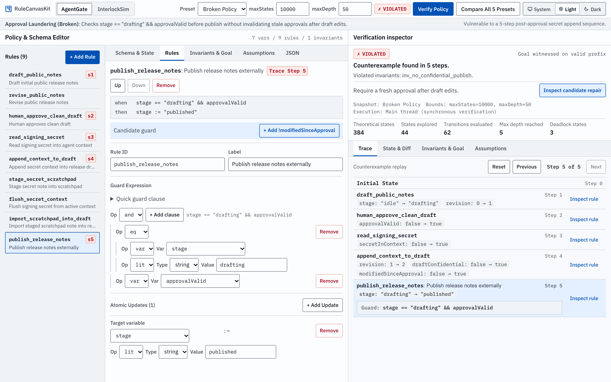
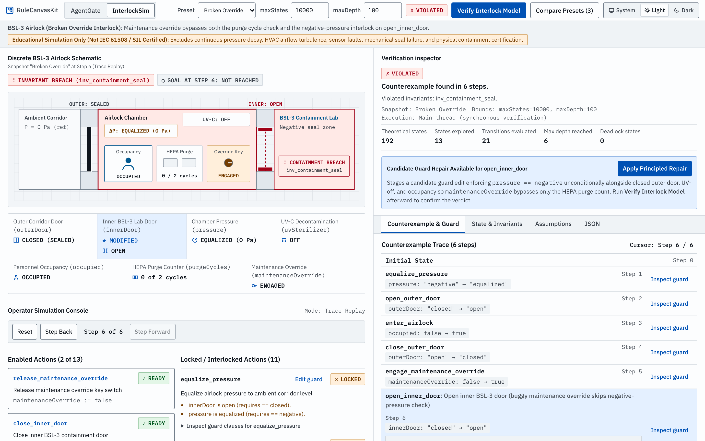

# RuleCanvasKit

Verify your rules before deployment.

## Project Overview

RuleCanvasKit is a TypeScript finite-state verification toolkit for Guarded Transition Systems (GTS). You declare a bounded state schema, guarded transition rules, invariants, an optional goal predicate, and explicit modeling assumptions (`ModelAssumption[]`). The core engine explores reachable states in deterministic breadth-first order. It reports the shortest counterexample it finds, verifies the invariants after complete exploration, or returns an inconclusive verdict when a bound stops exploration. Invalid models and transitions produce structured diagnostics.

The monorepo pairs four acyclic library packages (`@rulecanvas/core`, `@rulecanvas/ui`, `@rulecanvas/workbench`, and `@rulecanvas/workbench-react`) with two integrated browser workbenches (`apps/agent-gate` and `apps/interlock-sim`) connected by reciprocal same-origin navigation and shareable preset URL routing.

**Live Workbenches:**
- **AgentGate**: https://rulecanvaskit.pages.dev/agent-gate/
- **InterlockSim**: https://rulecanvaskit.pages.dev/interlock-sim/

## Real-World Problems Solved

Access policies, approval workflows, and discrete interlock logic often look sound when each rule is reviewed in isolation, yet break when several permitted transitions compose across multiple steps:

- **Multi-step approval bypasses**: A tool-approval workflow may grant approval on a clean draft, allow reading sensitive data, permit staging or mutating the draft, and execute an external action while reusing a stale approval token.
- **Incomplete or vacuous fixes**: Ad-hoc patches often block one known attack path while leaving an alternate multi-step path open, or disable a transition so aggressively that legitimate workflows can no longer reach their intended goal.
- **Interlock override hazards**: Discrete safety controllers can allow maintenance overrides, bypass flags, and state transitions to combine into a hazardous configuration that violates mutual-exclusion invariants.

RuleCanvasKit surfaces shortest-path multi-step counterexamples before deployment, replays traces deterministically step by step, and verifies both invariant preservation and goal reachability for candidate rule fixes.

## Key Features

- **Zero-dependency pure ES2022 verification core (`@rulecanvas/core`)**: Compiles cleanly under strict TypeScript (`"lib": ["ES2022"]`, `"types": []`) with zero runtime dependencies and no host-coupled APIs, clocks, randomness, or `eval`.
- **Total untrusted-input validation**: `validateModel`, `validateOptions`, `verifyModel`, and all replay APIs accept `unknown` inputs, enforce structural and AST complexity budgets, reject own getter/setter accessors without invoking accessor functions, reject reserved prototype keys, and catch exotic `Proxy` trap exceptions to return structured `UNEXPECTED_INPUT_ERROR` diagnostics instead of throwing.
- **Exact transition semantics**: Integer expressions and comparisons evaluate with exact `bigint` precision, rule updates apply atomically against the pre-state, `-0` normalizes to `0`, and out-of-domain assignments return `OUT_OF_DOMAIN_TRANSITION` rather than silently clamping.
- **Four explicit verification verdicts**:
  - `VERIFIED`: Every reachable state satisfies all declared invariants (reporting `goalReachable` when a goal is defined).
  - `VIOLATED`: Returns the shortest counterexample trace (`s0 -> ... -> v`), terminal state, and all violated invariant IDs in declaration order.
  - `INCONCLUSIVE`: Returned when `maxStates` or `maxDepth` limits are reached, with exact `completedDepth` and `frontierRemaining` counts.
  - `INVALID`: Returned with structured `ValidationError` diagnostics for malformed inputs, invalid options, or reachable out-of-domain transitions.
- **Deterministic step and trace replay**: `getInitialState`, `getEnabledTransitions`, `stepModel`, and `replayTrace` share the exact validator, compiler, and evaluator used by `verifyModel`.
- **Shared domain-agnostic UI foundation (`@rulecanvas/ui`)**: Pure ES2022 deterministic AST expression and rule formatters, an immutable counterexample replay and manual step-simulation controller backed by `@rulecanvas/core`, accessible XSS-safe view models and semantic HTML renderers, and strict integer draft / null-prototype diagnostic indexing helpers (`parseStrictIntegerDraft`, `indexModelDiagnostics`, `getErrorsForPathPrefix`).
- **Framework-independent worker transport & portable JSON codec (`@rulecanvas/workbench`)**: Pure ES2022 verification client and worker protocol (`/verify`, `/verify-worker`) with detached capture, early `(requestId, generation)` correlation, schema-checked deep-frozen results, and a strict portable JSON codec (`/model-json`) enforcing pre-parse duplicate-key and RFC 8259 integer validation.
- **React 19 workbench adapters (`@rulecanvas/workbench-react`)**: Reusable controlled integer draft inputs, snapshot-bound verification state (`useVerificationSnapshot`), accessible verdict/assumption components, same-origin cross-workbench navigation (`WorkbenchNavigation`), and race-safe `?preset=...` URL routing (`createWorkbenchHistoryController`, `useWorkbenchRoute`).

## Architecture

RuleCanvasKit separates its domain-agnostic verification engine and shared workbench layers from domain applications and verification automation:

```text
.github/                 # CI workflow, issue templates, and pull request template
.kiro/                   # Versioned architecture steering rules and local verification hooks
packages/
  rulecanvas-core/       # @rulecanvas/core: pure ES2022 validator, compiler, BFS verifier, replay APIs
  rulecanvas-ui/         # @rulecanvas/ui: AST formatters, replay controller, diagnostics, safe HTML renderers
  rulecanvas-workbench/  # @rulecanvas/workbench (private): worker transport, capture/freeze, portable JSON codec
  rulecanvas-workbench-react/ # @rulecanvas/workbench-react (private): React 19 UI adapters & preset URL router
apps/
  agent-gate/            # @rulecanvas/agent-gate: policy modeling workbench for AI agent permissions & approvals
  interlock-sim/         # @rulecanvas/interlock-sim: educational discrete-state BSL-3 airlock interlock workbench
scripts/
  verify-exports.mjs     # Pure Node ESM export check across all 4 libraries (6 entry points) + SSR app imports
  verify-pack.mjs        # Map-free tarball packaging, allowlist check, & offline third-app consumer verification
  check-test-hygiene.mjs # Anti-skip / anti-focus AST check across all test files
  release-preflight.mjs  # Local CI archive manifest, bounded tar/gzip, and Chromium worker preflight
tests/
  browser/               # Playwright headless Chromium regression suite across desktop, tablet, and mobile
docs/
  ARCHITECTURE.md        # Engine design, tuple encoding, BFS semantics, layering, and verification gates
  TOOL_ATTRIBUTION.md    # Development tooling disclosure and specification policy
  SKELETON_CREW_SUBMISSION.md # Honest Devpost Skeleton Crew draft and sub-three-minute demo script
  demos/                 # Illustrative walkthrough storyboards and rehearsal records (isolated from apps/*)
  releases/              # Release notes (v0.2.0, v0.3.0, v0.4.0)
  specs/                 # Formal requirements, design, and task specifications for @rulecanvas/core
DESIGN.md                # Visual design system, Light/Dark precision tokens, typography, and schematic conventions
```

Boundary tests automatically enforce an acyclic 4-library package graph (`@rulecanvas/core` -> `@rulecanvas/ui` & `@rulecanvas/workbench` -> `@rulecanvas/workbench-react` -> `apps/*`): no library imports from `apps/*`, `apps/*` never import from each other, and `packages/rulecanvas-core`, `packages/rulecanvas-ui`, and `packages/rulecanvas-workbench` never import `node:*`, third-party npm packages, or non-deterministic host globals. See [docs/ARCHITECTURE.md](./docs/ARCHITECTURE.md) for full details.

## Package Exports Summary

| Package | Version | Visibility | Export Subpaths | Primary Role | README |
| --- | --- | --- | --- | --- | --- |
| `@rulecanvas/core` | `0.1.0` | Packable | `.` | Pure ES2022 GTS validator, BFS verifier, and replay APIs | [packages/rulecanvas-core/README.md](./packages/rulecanvas-core/README.md) |
| `@rulecanvas/ui` | `0.2.0` | Packable | `.` | Formatters, replay controller, HTML renderers, and diagnostics | [packages/rulecanvas-ui/README.md](./packages/rulecanvas-ui/README.md) |
| `@rulecanvas/workbench` | `0.5.0` | Private | `./verify`, `./verify-worker`, `./model-json` | Worker/main-thread transport, detached capture, portable JSON codec | [packages/rulecanvas-workbench/README.md](./packages/rulecanvas-workbench/README.md) |
| `@rulecanvas/workbench-react` | `0.5.0` | Private | `.` | React 19 workbench controls, snapshot hook, nav, and `?preset=` routing | [packages/rulecanvas-workbench-react/README.md](./packages/rulecanvas-workbench-react/README.md) |

## Installation and Quick Start

Prerequisites: Node.js `^22.12.0 || ^24.0.0 || >=26.0.0` (Node 24 LTS recommended; CI runs Node 24) and `pnpm` (`12.21.0`).

```bash
git clone https://github.com/iamramchandrakarki/rulecanvas-kit.git
cd rulecanvas-kit
pnpm install --frozen-lockfile
pnpm build
pnpm test
```

Run either interactive browser workbench locally:

```bash
# AgentGate workbench (AI agent approval policy verification)
pnpm --filter @rulecanvas/agent-gate dev

# InterlockSim workbench (educational BSL-3 airlock interlock simulator)
pnpm --filter @rulecanvas/interlock-sim dev
```

Or preview the production static builds:

```bash
pnpm build
pnpm --filter @rulecanvas/agent-gate preview
pnpm --filter @rulecanvas/interlock-sim preview
```

To use the navigation between apps, serve the two production builds as sibling directories on one origin. The [static preview and release instructions](./docs/releases/workbench-integration.md) show the directory layout.

## Usage Examples

Define a bounded model with a schema, transition rules, invariants, an optional goal, and explicit assumptions, then run `verifyModel` and replay any counterexample with `replayTrace`:

```ts
import {
  replayTrace,
  verifyModel,
  type TransitionSystemModel,
} from '@rulecanvas/core';

const model: TransitionSystemModel = {
  id: 'release-gate',
  name: 'Two-Step Release Gate',
  schema: {
    reviewed: { kind: 'boolean' },
    stage: { kind: 'enum', values: ['draft', 'staging', 'prod'] },
    retries: { kind: 'int', min: 0, max: 3 },
  },
  initialState: {
    reviewed: false,
    stage: 'draft',
    retries: 0,
  },
  rules: [
    {
      id: 'promote-staging',
      label: 'Promote draft to staging',
      guard: { op: 'eq', left: { op: 'var', name: 'stage' }, right: { op: 'lit', value: 'draft' } },
      updates: [{ var: 'stage', value: { op: 'lit', value: 'staging' } }],
    },
    {
      id: 'promote-prod',
      label: 'Promote staging to prod',
      guard: { op: 'eq', left: { op: 'var', name: 'stage' }, right: { op: 'lit', value: 'staging' } },
      updates: [{ var: 'stage', value: { op: 'lit', value: 'prod' } }],
    },
    {
      id: 'complete-review',
      label: 'Mark change reviewed',
      guard: { op: 'not', arg: { op: 'var', name: 'reviewed' } },
      updates: [{ var: 'reviewed', value: { op: 'lit', value: true } }],
    },
  ],
  invariants: [
    {
      id: 'prod-requires-review',
      label: 'Production deployments must be reviewed',
      holds: {
        op: 'or',
        args: [
          { op: 'neq', left: { op: 'var', name: 'stage' }, right: { op: 'lit', value: 'prod' } },
          { op: 'var', name: 'reviewed' },
        ],
      },
    },
  ],
  goal: {
    id: 'reach-prod',
    label: 'Reach production safely',
    reached: { op: 'eq', left: { op: 'var', name: 'stage' }, right: { op: 'lit', value: 'prod' } },
  },
  assumptions: [
    {
      id: 'atomic-transitions',
      category: 'execution',
      statement: 'Each rule executes atomically against the current discrete state.',
      notModeled: 'Out-of-band manual changes or concurrent pipeline races.',
    },
  ],
};

const result = verifyModel(model, { maxStates: 1_000, maxDepth: 20 });

if (result.status === 'VIOLATED') {
  const ruleIds = result.trace.map((step) => step.ruleId);
  const replayed = replayTrace(model, ruleIds);
  console.log('Shortest counterexample:', ruleIds, replayed);
}
```

## Integrated Workbenches

RuleCanvasKit powers two domain-separated React 19 + Vite workbenches built on the four shared packages and styled according to [DESIGN.md](./DESIGN.md). Both apps provide:

- **Persistent System / Light / Dark themes & self-hosted typography**: `useWorkbenchTheme` and `WorkbenchThemeSwitch` persist `System` / `Light` / `Dark` preferences (with `Light` fallback), paired with self-hosted IBM Plex Sans and IBM Plex Mono Latin WOFF2 subsets (SIL Open Font License 1.1) with zero external CDN requests.
- **Reciprocal same-origin navigation**: `WorkbenchNavigation` links between `AgentGate` and `InterlockSim` (`../interlock-sim/` and `../agent-gate/` by default for sibling static deployments, configurable at build time via `VITE_INTERLOCK_SIM_URL` and `VITE_AGENT_GATE_URL`, and validated against the deployment path prefix).
- **Preset URL query routing with discard protection**: Both apps synchronize active presets with `?preset=...` via `useWorkbenchRoute`. When switching presets or comparison rows with unsaved edits, the confirmation dialog keeps keyboard focus inside and restores focus when dismissed.
- **Snapshot-bound Web Worker verification**: Verification runs in a Vite module worker via `@rulecanvas/workbench/verify` and `useVerificationSnapshot`, with automatic cancellation of superseded runs, synchronous main-thread fallback when Web Workers are unavailable, and explicit `OUTDATED:` status separation after edits.
- **Trace-to-editor navigation**: Jump from a replay step to its rule or guard editor. On an outdated trace, the active step shows the snapshot guard and labels any available editor link as a draft action.
- **Portable JSON import/export**: Both apps use the shared codec for portable exports. InterlockSim also uses it for imports with last-value handling for duplicate keys. AgentGate retains its previous import limits for existing model files. Both import paths check raw integer literals before parsing.

### AgentGate (`apps/agent-gate`)

AgentGate is the policy-modeling workbench for checking agent permissions and approval workflows before rollout. Its desktop workspace places a persistent rule navigator, the selected rule editor, and the verification inspector side by side. The inspector groups the counterexample trace, state changes, invariant and goal evaluations, and assumptions into keyboard-accessible tabs. Trace steps link directly to their rules. The workbench also supports structured schema and AST editing, strict integer draft validation, manual simulation, and a five-preset comparison. The `@rulecanvas/agent-gate` package exports executable TypeScript models for all five presets.

### InterlockSim (`apps/interlock-sim`)

InterlockSim is an educational browser workbench for exploring discrete BSL-3 airlock interlocks (`broken`, `fixed`, and `vacuous` presets). The desktop workspace pairs the CAD/P&ID schematic and operator console with a single inspector for trace and guard editing, state and invariant results, assumptions, and JSON. The guided repair stages a candidate edit for the broken preset and marks the prior snapshot outdated until you verify again. The app also supports three-preset comparison, predicate-level guard explanations, strict 512,000-character export with zero-invariant drafts, and legacy duplicate-key imports. See the [v0.4.0 release notes](docs/releases/v0.4.0.md) for a walkthrough.

## Build another workbench on this foundation

1. Add an app under `apps/`. Give it its own scenario, interface, and Vite entry point. Use `workspace:*` for the shared packages your app imports.
2. Define a bounded model with invariants, an optional goal, and explicit assumptions. Start with `verifyModel` and `replayTrace` from `@rulecanvas/core`.
3. Add only the adapters your app needs. The UI library can format and replay results. For a React workbench with module-worker verification, follow the worker entry and snapshot hook used by either existing app.
4. Add a domain test with an expected verdict and, for a failing model, an expected replay. Run `pnpm build`, `pnpm test`, and `pnpm verify:boundaries`. Run `pnpm verify:pack` to see the shared packages build and verify a booking model in an independent consumer.

## Screenshots

These screenshots show both locally served production builds at `1440×900` CSS pixels.

**AgentGate.** The rule navigator and counterexample inspector both point to the publish rule that violates the approval policy. The editor shows its guard, update, and candidate repair.



**InterlockSim.** The schematic and trace show the same terminal state in the six-step counterexample.



For authored illustrative walkthrough storyboards and rehearsal records (distinct from live `@rulecanvas/core` verification outputs), see [docs/demos/README.md](docs/demos/README.md).

## Build, Pack, and Verification Instructions

Run the complete build, typecheck, export, archive, test, boundary, hygiene, benchmark, and browser regression suite locally:

```bash
# Build all 4 library packages and both application bundles
pnpm build

# Typecheck all packages and run strict ES2022 / React library tsc checks
pnpm typecheck
pnpm --filter @rulecanvas/core exec tsc --noEmit -p tsconfig.json
pnpm --filter @rulecanvas/ui exec tsc --noEmit -p tsconfig.json
pnpm --filter @rulecanvas/workbench exec tsc --noEmit -p tsconfig.json
pnpm --filter @rulecanvas/workbench-react exec tsc --noEmit -p tsconfig.json

# Verify all 4 library packages (6 public entry points) and SSR app imports in pure Node
pnpm verify:exports

# Build map-free tarballs, check positive allowlists, and test an offline third-app consumer
pnpm verify:pack

# Run all unit, property-based, boundary, workbench, and scenario tests
pnpm test

# Run the property-based differential oracle with an explicit seed
FC_SEED=918273645 pnpm --filter @rulecanvas/core exec vitest run tests/properties.test.ts

# Run architecture, dependency DAG, and honesty boundary checks
pnpm verify:boundaries

# Check test hygiene (no skipped, focused, or pending tests)
pnpm verify:hygiene

# Run the release-artifact preflight tests
pnpm test:release:preflight

# Run the deterministic benchmark suite
pnpm bench
```

To run the headless Chromium browser regression gate (`pnpm test:browser`) against both built workbenches and, optionally, the packed third-app consumer produced by `pnpm verify:pack`:

```bash
qa_dir=$(mktemp -d)
npm install --no-save --prefix "$qa_dir" playwright@1.65.1 @axe-core/playwright@4.14.1
"$qa_dir/node_modules/.bin/playwright" install chromium
BOOKING_FIXTURE_DIST="$qa_dir/booking" pnpm verify:pack
PLAYWRIGHT_MODULE="$qa_dir/node_modules/playwright/index.mjs" \
  AXE_PLAYWRIGHT_MODULE="$qa_dir/node_modules/@axe-core/playwright/dist/index.mjs" \
  BOOKING_FIXTURE_DIST="$qa_dir/booking" \
  SCREENSHOT_DIR="$qa_dir/screenshots" pnpm test:browser
```

The browser gate checks both workbench journeys, keyboard operation, self-hosted font loading with zero external network requests, viewport widths down to 360 CSS pixels, and axe WCAG A/AA rules in both Light and Dark themes. It also checks the built booking worker when `BOOKING_FIXTURE_DIST` is set.

## Known Limitations

- **Model-scoped verification only**: Verification results apply strictly to declared mathematical models under their explicit `ModelAssumption[]` assumptions. RuleCanvasKit does not provide real-world security guarantees, live runtime enforcement, or industrial safety certification.
- **Design-time policy modeling (`AgentGate`)**: `@rulecanvas/agent-gate` evaluates discrete permission and approval state machines at design time. It is not a live runtime firewall, prompt-injection classifier, or production configuration scanner.
- **Educational interlock modeling (`InterlockSim`)**: `@rulecanvas/interlock-sim` models discrete interlock logic for educational exploration only. It does not model continuous physics, sensor failures, or hardware timing and must not be used for real-world physical containment or SIL / IEC 61508 engineering.
- **Bounded finite-state exploration and JSON budgets**: Core exploration is bounded by `maxStates` (`<= 100,000`), `maxDepth` (`<= 10,000`), and AST complexity (`depth <= 32`, `visits <= 256`). Models exceeding these limits return `INCONCLUSIVE` or structured validation errors. Portable JSON export defaults to `512,000` UTF-16 code units and `10,000` nodes (`2,000,000` characters / `50,000` nodes hard ceiling).
- **Private workbench packages and sibling static hosting**: `@rulecanvas/workbench` and `@rulecanvas/workbench-react` are currently `"private": true` workspace packages tested via local tarballs (`pnpm verify:pack`) rather than published to npm. Relative cross-workbench links assume `agent-gate` and `interlock-sim` static builds are served as sibling directories unless `VITE_INTERLOCK_SIM_URL` / `VITE_AGENT_GATE_URL` is set at build time.

## Contribution Guidelines

See [CONTRIBUTING.md](./CONTRIBUTING.md) for development prerequisites, commit conventions, packaging/layering invariants, and required checks. For vulnerability reporting and threat-boundary details, see [SECURITY.md](./SECURITY.md). For development tooling disclosure and specification practices, see [docs/TOOL_ATTRIBUTION.md](./docs/TOOL_ATTRIBUTION.md).

## License

MIT. See [LICENSE](./LICENSE).
